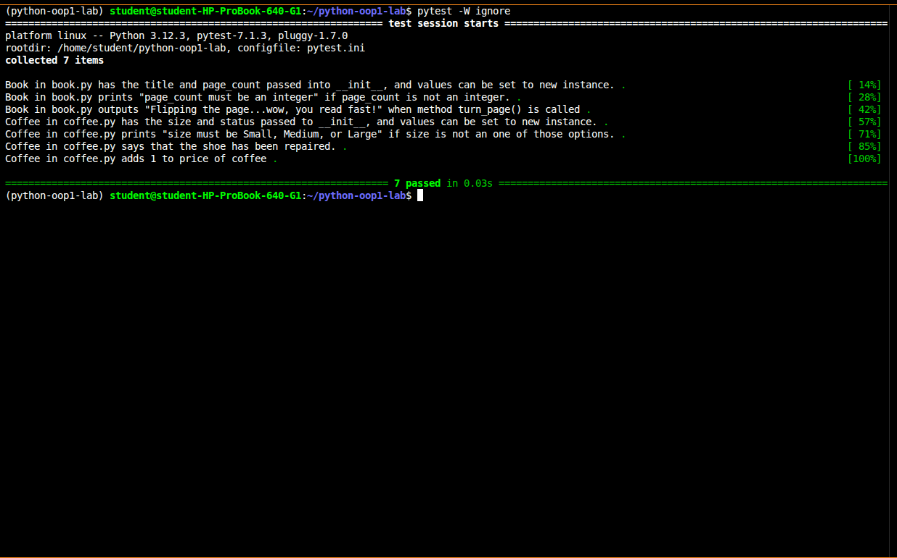

# Bookstore Classes

Two Python classes that model items in a bookstore: `Book` and `Coffee`.

## Features
- `Book(title, page_count)`: `turn_page()` prints a message. `page_count` must be an integer.
- `Coffee(size, price)`: `size` must be Small, Medium, or Large. `tip()` prints a message and raises the price by 1.

## Setup
    pipenv install
    pipenv shell

## Usage
    from lib.book import Book
    from lib.coffee import Coffee

    book = Book("Dune", 412)
    book.turn_page()

    coffee = Coffee("Large", 4)
    coffee.tip()
    print(coffee.price)  # 5

## Running tests
    pytest

## Screenshot
